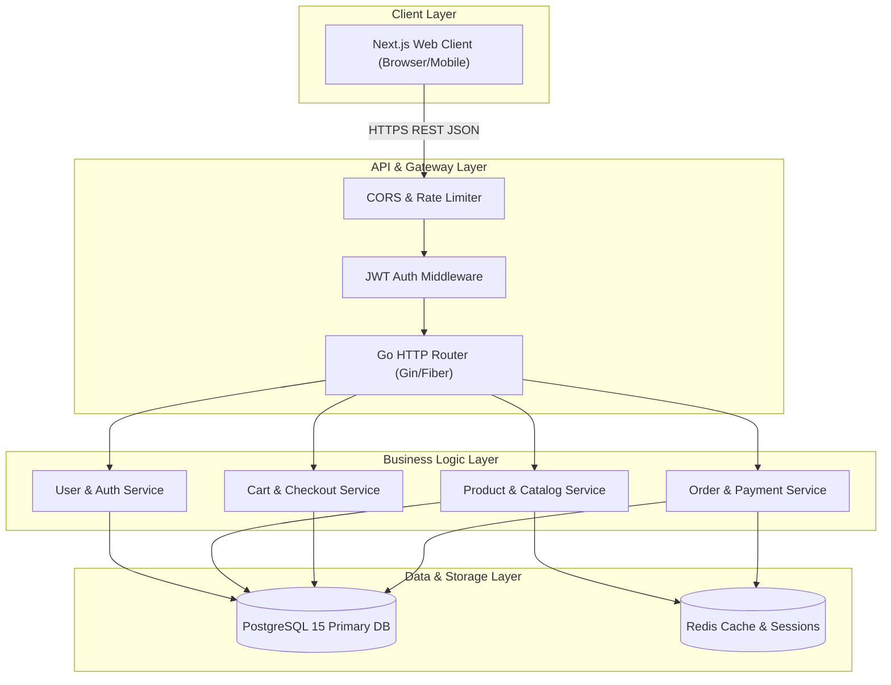

# System Architecture Document - E-Commerce Platform

**Versi:** 1.0  
**Status:** Approved  
**Teknologi Utama:** Next.js (TypeScript) & Go (Golang) REST API  

---

## 1. Tinjauan Sistem (System Overview)

Platform E-Commerce dirancang menggunakan **Decoupled Client-Server Architecture** (Arsitektur Terpisah). Antarmuka pengguna (Frontend) dan layanan bisnis utama (Backend) beroperasi secara independen dan berkomunikasi melalui protokol **RESTful API** dengan pertukaran data berformat JSON.



---

## 2. Deskripsi Komponen Layanan (Component Breakdown)

### 2.1. Frontend Layer (Next.js + TypeScript)
- **Framework**: Next.js (App Router) menggunakan TypeScript.
- **Rendering Strategy**:
  - **Server-Side Rendering (SSR)** / **Server Components**: Untuk halaman publik katalog produk dan halaman detail produk demi optimasi SEO dan kecepatan muat awal.
  - **Client-Side Rendering (CSR)**: Untuk komponen interaktif seperti Keranjang Belanja, Form Checkout, dan Dasbor Admin.
- **State Management**: React Context API & Custom Hooks untuk manajemen status keranjang belanja dan sesi pengguna.
- **API Client**: Service layer tersentralisasi menggunakan Fetch/Axios instance dengan interceptor otomatis untuk penyisipan token JWT (`Bearer Token`).

### 2.2. Backend Layer (Go REST API)
- **Language & Framework**: Go (Golang) versi 1.22+ dengan web framework tinggi performa (Gin / Fiber).
- **Arsitektur Kode (Clean Architecture / Layered Architecture)**:
  1. **Handler / Controller Layer**: Menerima HTTP request, melakukan validasi payload DTO, dan mengembalikan HTTP response JSON standar.
  2. **Service / Business Logic Layer**: Pemrosesan logika bisnis (misal: kalkulasi harga total, komitmen transaksi stok, validasi role pengguna).
  3. **Repository / Data Access Layer**: Interaksi langsung ke PostgreSQL menggunakan SQL query teroptimasi / ORM (GORM / SQLx).
  4. **Middleware Layer**: Penanganan autentikasi JWT, CORS, Logging request, dan Recovery panic.

### 2.3. Data Storage Layer
- **PostgreSQL**: Database utama untuk menyimpan data terstruktur seperti Pengguna, Produk, Kategori, Keranjang, dan Pesanan secara relational.
- **Redis Cache**: Caching sementara untuk katalog produk populer dan sesi token yang di-revoke (blacklisted tokens).

---

## 3. Protokol & Format Komunikasi API

Semua endpoint API berkomunikasi menggunakan HTTPS dengan payload format JSON. 

### 3.1. Standard Response Structure
Setiap respons dari API Backend selalu mengikuti format yang konsisten:

#### Success Response Example:
```json
{
  "success": true,
  "message": "Product retrieved successfully",
  "data": {
    "id": "c7b8a1e2-9d3f-4e5a-8b1c-2d3e4f5a6b7c",
    "name": "Wireless Mechanical Keyboard",
    "price": 850000,
    "stock": 15
  }
}
```

#### Error Response Example:
```json
{
  "success": false,
  "message": "Invalid product ID or product not found",
  "error": "PRODUCT_NOT_FOUND"
}
```

---

## 4. Keamanan Sistem (Security Architecture)

> [!IMPORTANT]
> Seluruh transaksi pembayaran dan perubahan status data sensitif wajib dilindungi oleh otentikasi ketat dan validasi server-side.

1. **Otentikasi Token JWT**:
   - **Access Token**: Masa berlaku singkat (misal 15 menit), dikirim via header `Authorization: Bearer <token>`.
   - **Refresh Token**: Masa berlaku lebih panjang (misal 7 hari), disimpan secara aman (`HttpOnly`, `SameSite`, `Secure` cookie) untuk memperbarui access token.
2. **Password Security**: Kata sandi pengguna di-hash menggunakan algoritma **Bcrypt** dengan cost factor minimal 10.
3. **CORS (Cross-Origin Resource Sharing)**: Backend hanya menerima request dari domain frontend yang diizinkan (*Whitelisted origins*).
4. **Data Sanitization & SQL Protection**: Penggunaan parameterized queries di backend untuk mencegah serangan SQL Injection.
