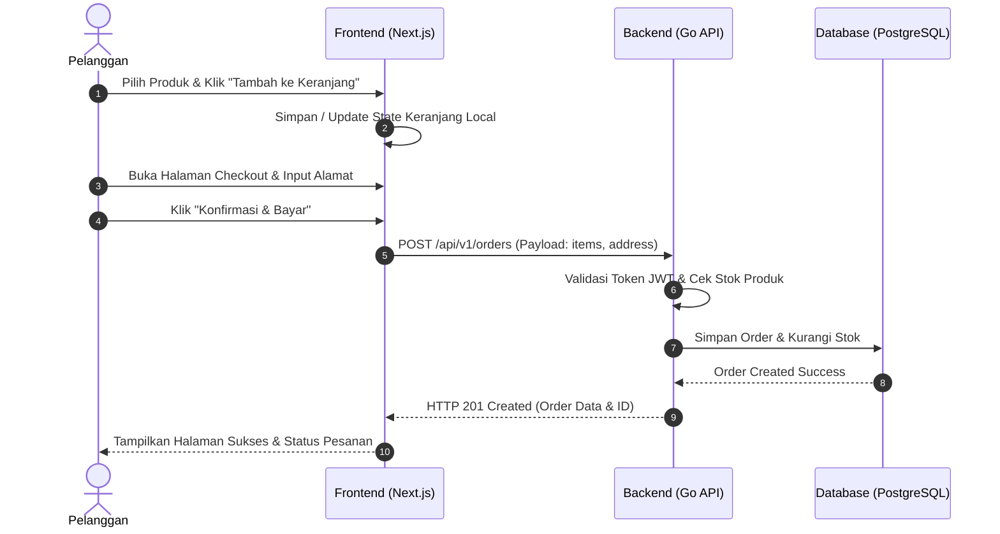

# UI/UX & Visual Design Document - E-Commerce Platform

**Versi:** 1.0  
**Standar Desain:** Modern, Clean, Dynamic, & Premium Aesthetics  

---

## 1. Filosofi Desain UI/UX

Aplikasi E-Commerce ini mengusung pendekatan **Modern Glassmorphism & High-Contrast Visuals** yang dipadukan dengan *Mobile-First Design*. Pengguna diuntungkan oleh antarmuka yang cepat, navigasi jernih, serta aksen mikro-animasi halus untuk memberikan pengalaman belanja kelas atas.

> [!TIP]
> Antarmuka mengutamakan kejelasan hirarki visual, ruang napas (*whitespace* yang seimbang), serta responsivitas tinggi pada setiap aksi tombol.

---

## 2. Palette Warna & Tipografi (Design Tokens)

### 2.1. Color Palette

```css
:root {
  /* Primary & Accent Colors */
  --color-primary: #4f46e5;          /* Indigo 600 - Main Brand Color */
  --color-primary-hover: #4338ca;    /* Indigo 700 */
  --color-accent: #06b6d4;           /* Cyan 500 - Highlight Accent */
  
  /* Background & Surface */
  --color-bg-main: #0f172a;          /* Slate 900 - Dark Theme Default */
  --color-surface-card: #1e293b;     /* Slate 800 */
  --color-surface-glass: rgba(30, 41, 59, 0.7); /* Glassmorphism Overlay */
  --color-border: #334155;           /* Slate 700 */

  /* Text Colors */
  --color-text-main: #f8fafc;        /* Slate 50 */
  --color-text-muted: #94a3b8;       /* Slate 400 */

  /* Status Colors */
  --color-success: #10b981;         /* Emerald 500 */
  --color-warning: #f59e0b;         /* Amber 500 */
  --color-danger: #ef4444;          /* Red 500 */
}
```

### 2.2. Tipografi
- **Primary Font**: `Inter` / `Outfit` (Google Fonts)
- **Heading Scale**: `h1` (36px/48px bold), `h2` (28px/36px semibold), `h3` (20px/28px medium).
- **Body Text**: `14px` - `16px` dengan line-height `1.6`.

---

## 3. Tata Letak Halaman (Page Wireframes & Layouts)

### 3.1. Navbar & Header Utama (Global)
- **Kiri**: Logo Brand E-Commerce + Menu Navigasi (Beranda, Produk, Kategori).
- **Tengah**: Search bar interaktif dengan pencarian langsung (*instant search dropdown*).
- **Kanan**: Tombol Cart dengan *badge counter* kuantitas, Tombol Pengguna (Profile / Login).

### 3.2. Halaman Beranda (Landing Page - `/`)
1. **Hero Section**: Banner promo besar dengan background gradien gelap dan efek pencahayaan cyan/indigo.
2. **Category Grid**: Kartu kategori dengan ikon unik dan efek *hover scaling*.
3. **Featured Products Section**: Carousel/Grid produk terlaris dengan badge harga dan bintang ulasan.
4. **Trust Badges**: Garansi Pengiriman, Pembayaran Aman 24/7, Dukungan Pelanggan.

### 3.3. Halaman Katalog Produk (`/products`)
```
+-----------------------------------------------------------------------+
|  Breadcrumb: Home > Products                                          |
+-------------------+---------------------------------------------------+
|  FILTER SIDEBAR   |  SEARCH & SORT BAR                                |
|  - Category       |  [ Search Products... ]  [ Sort: Price Low-High v]|
|  - Price Range    +---------------------------------------------------+
|  - Stock Status   |  PRODUCT GRID (3 atau 4 kolom)                    |
|  - Rating         |  +-------------+  +-------------+  +-------------+ |
|                   |  | Image       |  | Image       |  | Image       | |
|  [ Apply Filter ] |  | Title       |  | Title       |  | Title       | |
|                   |  | Price       |  | Price       |  | Price       | |
|                   |  | [Add to Cart|  | [Add to Cart|  | [Add to Cart| |
|                   |  +-------------+  +-------------+  +-------------+ |
+-------------------+---------------------------------------------------+
```

### 3.4. Halaman Detail Produk (`/products/[id]`)
- **Sisi Kiri**: Galeri Foto Produk utama + Thumbnail selector.
- **Sisi Kanan**: Title, Badge Stok, Rating, Harga (dengan format Rupiah `Rp`), Pilihan Varian, Deskripsi Singkat, Tombol `+` / `-` Kuantitas, serta Tombol `Tambah ke Keranjang` & `Beli Sekarang`.

### 3.5. Halaman Keranjang Belanja (`/cart`) & Checkout (`/checkout`)
- **Layout Keranjang**: Tabel item keranjang (Gambar, Nama, Harga, Kontrol Kuantitas, Hapus) + Card Ringkasan Total Belanja di sisi kanan.
- **Layout Checkout**: Accordion/Stepper 3 langkah:
  1. Alamat Pengiriman
  2. Metode Pembayaran (Simulasi Bank Transfer / E-Wallet)
  3. Konfirmasi & Bayar

---

## 4. Alur Visual Pengguna (User Flow Diagrams)

### 4.1. Alur Pembelian Pelanggan (Customer Purchase Flow)



---

## 5. Dasbor Admin (Admin Visual Layout)

1. **Sidebar Navigation**: Overview Dashboard, Products, Categories, Orders, Customers, Settings.
2. **Dashboard Cards**:
   - Total Revenue (Rp)
   - Active Orders Count
   - Low Stock Alert Count
   - Total Customers
3. **Data Tables**: Dilengkapi dengan fitur pencarian internal, filter status, dan tombol aksi (Edit, Delete, View Detail).
