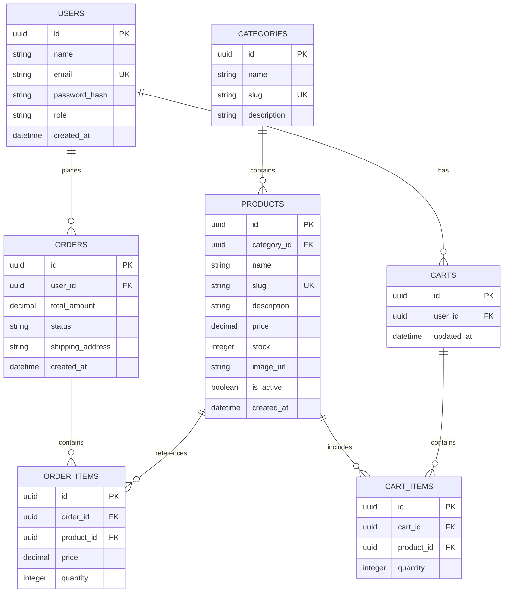

# Product Requirement Document (PRD) - Full-Stack E-Commerce Platform

**Versi:** 1.0  
**Tanggal:** 26 Juli 2026  
**Status:** Proposed / Draft  
**Penulis:** Antigravity AI & User  

---

## 1. Ringkasan Eksekutif (Executive Summary)

Platform **E-Commerce** ini adalah aplikasi web toko online full-stack yang dirancang modern, responsif, aman, dan memiliki performa tinggi. Aplikasi ini memisahkan arsitektur antarmuka (Frontend - Next.js) dan layanan backend (Backend - Go REST API). 

Platform menyediakan dua pengalaman utama:
1. **Portal Pelanggan (Customer Portal)**: Antarmuka belanja yang interaktif untuk penelusuran produk, manajemen keranjang belanja, proses checkout, dan pelacakan pesanan.
2. **Dasbor Merchant/Admin (Admin Dashboard)**: Antarmuka manajemen inventaris, pemrosesan pesanan, manajemen katalog produk, serta pemantauan analitik penjualan.

---

## 2. Tujuan & Sasaran Utama (Goals & Objectives)

1. **Pengalaman Pengguna (UX/UI) Premium**: Menyajikan desain web modern yang dinamis, cepat, dan intuitif berbasis antarmuka responsif (*Mobile-First*).
2. **Arsitektur Terpisah (Decoupled Architecture)**: Frontend menggunakan **Next.js (TypeScript)** dan Backend menggunakan **Go (Golang)** REST API untuk performa maksimal dan skalabilitas.
3. **Manajemen Transaksi & Stok Terintegrasi**: Mengelola alur pemesanan secara konsisten dan memperbarui stok barang secara akurat.
4. **Keamanan Berstandar Industri**: Implementasi otentikasi berbasis **JWT** (Access & Refresh Token), **Role-Based Access Control (RBAC)**, hashing kata sandi aman, serta validasi data input.

---

## 3. Peran Pengguna (User Roles & Permissions)

| Peran (Role) | Deskripsi | Hak Akses Utama |
|---|---|---|
| **Guest / Visitor** | Pengguna publik (belum terautentikasi) | Melihat halaman beranda, katalog produk, pencarian produk, filter kategori, detail produk. |
| **Customer** | Pelanggan terdaftar | Login/Register, mengelola profil & alamat pengiriman, mengelola keranjang belanja, melakukan checkout/pemesanan, melacak status pesanan, riwayat transaksi. |
| **Admin / Merchant** | Pengelola sistem & toko | Login Admin, Dasbor Analitik, CRUD Produk & Kategori, Manajemen Stok Produk, Mengubah Status Pesanan, Manajemen Pengguna. |

---

## 4. Spesifikasi Fitur (Functional Requirements)

### 4.1. Modul Otentikasi & Otorisasi
- **Registrasi & Login Pengguna**: Pendaftaran akun menggunakan email dan kata sandi dengan verifikasi input.
- **Manajemen Sesi JWT**: Penggunaan token JWT aman untuk otorisasi API request.
- **Role-Based Access Control (RBAC)**: Proteksi rute halaman & endpoint API sesuai peran (`Customer` vs `Admin`).

### 4.2. Katalog & Pencarian Produk (Customer Side)
- **Halaman Utama (Landing Page)**: Banner promosi, produk unggulan (*featured products*), dan kategori populer.
- **Katalog Produk**: Grid produk responsif dengan fitur pagination/infinite scroll.
- **Pencarian & Filter**: Filter berdasarkan kategori, rentang harga, dan kata kunci nama produk.
- **Detail Produk**: Multi-foto produk, harga, deskripsi lengkap, ketersediaan stok, dan tombol tambah ke keranjang.

### 4.3. Keranjang Belanja & Checkout (Customer Side)
- **Shopping Cart**: Tambah produk, ubah kuantitas, hapus barang, dan kalkulasi otomatis ringkasan belanja.
- **Formulir Checkout**: Pemilihan/input alamat pengiriman, pemilihan metode pembayaran (simulasi/sandbox payment).
- **Manajemen Pesanan Pelanggan**: Daftar riwayat pesanan dengan indikator status (`Pending`, `Paid`, `Processing`, `Shipped`, `Completed`, `Cancelled`).

### 4.4. Dasbor Pengelola (Admin Side)
- **Manajemen Produk (CRUD)**: Form tambah/edit produk (nama, deskripsi, harga, stok, upload gambar, kategori), hapus produk.
- **Manajemen Kategori**: Tambah/edit/hapus kategori barang.
- **Pemrosesan Pesanan**: Melihat semua pesanan masuk, memfilter berdasarkan status, dan memperbarui status pesanan.
- **Ringkasan Analitik**: Metric card (Total Penjualan, Total Pesanan, Total Produk, Total Pelanggan) dan tabel pesanan terbaru.

---

## 5. Arsitektur Teknis & Stack Teknologi

### 5.1. Tech Stack
- **Frontend App**: Next.js (React 18/19), TypeScript, Tailwind CSS / Custom CSS, Lucide React Icons.
- **Backend Service**: Go (Golang) dengan framework HTTP (Gin / Fiber / Chi), GORM / SQLx.
- **Database**: PostgreSQL (Relational Database) untuk penyimpan data utama.
- **Autentikasi**: JWT (JSON Web Token) + Bcrypt password hashing.

### 5.2. Skema Entitas Database Utama (ERD High-Level)

---

## 6. Persyaratan Non-Fungsional (Non-Functional Requirements)

1. **Performa (Performance)**: Response time API < 200ms untuk sebagian besar baca operasi. Page load time < 2 detik.
2. **Keamanan (Security)**: Sanitasi input anti SQL Injection & XSS, CORS policy terkonfigurasi, proteksi header HTTP.
3. **Usabilitas (Usability)**: Antarmuka bersih, responsif di seluler (Mobile) maupun desktop, kontras warna yang baik.
4. **Reliabilitas**: Penanganan error yang informatif di sisi frontend maupun API backend.

---

## 7. Rencana Tahapan Pengembangan (Implementation Roadmap)

### **Fase 1: Setup Foundation & Authentication**
- Inisialisasi proyek Frontend (Next.js) & Backend (Go).
- Setup koneksi database PostgreSQL & migrasi schema.
- Fitur registrasi, login, dan middleware autentikasi JWT.

### **Fase 2: Product & Inventory Management**
- Endpoint API CRUD Produk & Kategori di Backend.
- Dasbor Admin untuk manajemen produk & kategori di Frontend.

### **Fase 3: Customer Experience & Catalog**
- Landing page, katalog produk, filter & pencarian di Frontend.
- Detail produk & keranjang belanja (Cart).

### **Fase 4: Order Flow & Checkout**
- Process checkout & pembuatan pesanan.
- Alur pemrosesan status pesanan oleh Admin & pelacakan oleh Customer.
- Polishing UI/UX dan pengujian akhir.
