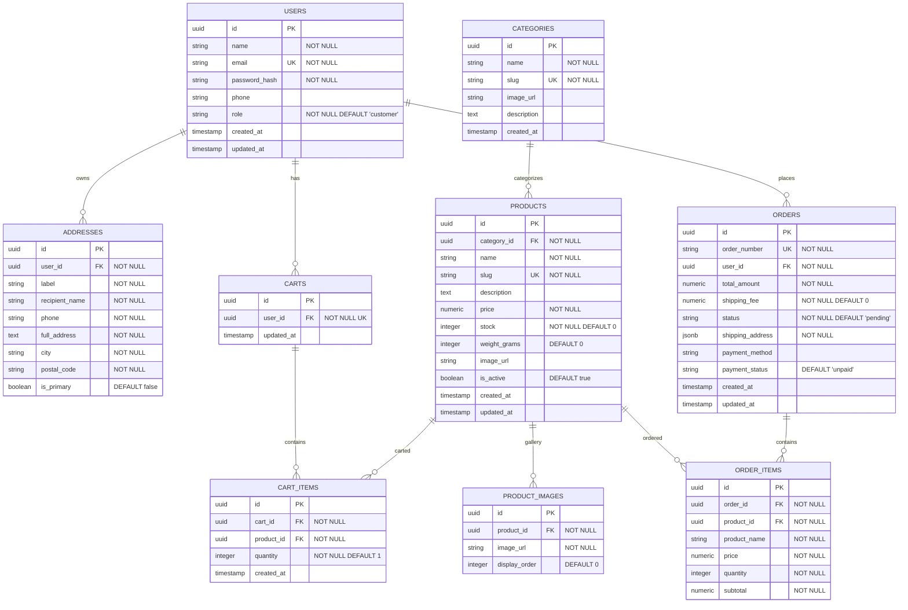

# Database Schema Document - E-Commerce Platform

**Database Engine:** PostgreSQL 15+  
**ORM / Data Access:** GORM / SQLx (Go)  
**ID Strategy:** UUID v4 (Primary Key untuk semua tabel)  

---

## 1. Diagram Relasi Entitas (Complete ERD)



---

## 2. Kamus Data & Spesifikasi Tabel

### 2.1. Tabel `users`
Menyimpan informasi kredensial dan identitas pengguna (Customer & Admin).

| Nama Kolom | Tipe Data | Constraint | Deskripsi |
|---|---|---|---|
| `id` | `UUID` | `PRIMARY KEY, DEFAULT gen_random_uuid()` | Identifier unik pengguna |
| `name` | `VARCHAR(100)` | `NOT NULL` | Nama lengkap pengguna |
| `email` | `VARCHAR(150)` | `UNIQUE, NOT NULL` | Email untuk login |
| `password_hash` | `VARCHAR(255)` | `NOT NULL` | Hash password bcrypt |
| `phone` | `VARCHAR(20)` | `NULL` | Nomor telepon / WhatsApp |
| `role` | `VARCHAR(20)` | `NOT NULL, DEFAULT 'customer'` | Values: `'customer'`, `'admin'` |
| `created_at` | `TIMESTAMPTZ` | `NOT NULL, DEFAULT NOW()` | Waktu registrasi |
| `updated_at` | `TIMESTAMPTZ` | `NOT NULL, DEFAULT NOW()` | Waktu pembaruan terakhir |

---

### 2.2. Tabel `addresses`
Menyimpan daftar alamat pengiriman milik pengguna.

| Nama Kolom | Tipe Data | Constraint | Deskripsi |
|---|---|---|---|
| `id` | `UUID` | `PRIMARY KEY, DEFAULT gen_random_uuid()` | ID Alamat |
| `user_id` | `UUID` | `FOREIGN KEY (users.id) ON DELETE CASCADE` | Owner alamat |
| `label` | `VARCHAR(50)` | `NOT NULL` | Contoh: 'Rumah', 'Kantor' |
| `recipient_name` | `VARCHAR(100)` | `NOT NULL` | Nama penerima paket |
| `phone` | `VARCHAR(20)` | `NOT NULL` | No telepon penerima |
| `full_address` | `TEXT` | `NOT NULL` | Alamat lengkap (jalan, RT/RW, dsb) |
| `city` | `VARCHAR(100)` | `NOT NULL` | Kota / Kabupaten |
| `postal_code` | `VARCHAR(10)` | `NOT NULL` | Kode pos |
| `is_primary` | `BOOLEAN` | `NOT NULL, DEFAULT false` | Penanda alamat utama |

---

### 2.3. Tabel `categories`
Kategori pengelompokan produk.

| Nama Kolom | Tipe Data | Constraint | Deskripsi |
|---|---|---|---|
| `id` | `UUID` | `PRIMARY KEY` | ID Kategori |
| `name` | `VARCHAR(100)` | `NOT NULL` | Nama kategori |
| `slug` | `VARCHAR(120)` | `UNIQUE, NOT NULL` | URL Slug (misal: `elektronik-pria`) |
| `image_url` | `TEXT` | `NULL` | Gambar ikon kategori |
| `description` | `TEXT` | `NULL` | Deskripsi singkat |
| `created_at` | `TIMESTAMPTZ` | `DEFAULT NOW()` | Waktu pembuatan |

---

### 2.4. Tabel `products`
Daftar produk e-commerce yang dijual.

| Nama Kolom | Tipe Data | Constraint | Deskripsi |
|---|---|---|---|
| `id` | `UUID` | `PRIMARY KEY` | ID Produk |
| `category_id` | `UUID` | `FOREIGN KEY (categories.id) ON DELETE RESTRICT` | Kategori produk |
| `name` | `VARCHAR(200)` | `NOT NULL` | Nama produk |
| `slug` | `VARCHAR(220)` | `UNIQUE, NOT NULL` | URL Friendly Slug |
| `description` | `TEXT` | `NULL` | Deskripsi lengkap produk |
| `price` | `NUMERIC(12, 2)` | `NOT NULL, CHECK (price >= 0)` | Harga dalam Rupiah |
| `stock` | `INT` | `NOT NULL, DEFAULT 0, CHECK (stock >= 0)` | Stok barang |
| `weight_grams` | `INT` | `NOT NULL, DEFAULT 0` | Berat barang (gram) |
| `image_url` | `TEXT` | `NULL` | Gambar utama produk |
| `is_active` | `BOOLEAN` | `NOT NULL, DEFAULT true` | Status visibilitas di toko |
| `created_at` | `TIMESTAMPTZ` | `DEFAULT NOW()` | Waktu produk dibuat |
| `updated_at` | `TIMESTAMPTZ` | `DEFAULT NOW()` | Waktu update terakhir |

---

### 2.5. Tabel `orders`
Header transaksi pemesanan.

| Nama Kolom | Tipe Data | Constraint | Deskripsi |
|---|---|---|---|
| `id` | `UUID` | `PRIMARY KEY` | ID Pesanan |
| `order_number` | `VARCHAR(50)` | `UNIQUE, NOT NULL` | Kode unik pesanan (misal: `INV/20260726/001`) |
| `user_id` | `UUID` | `FOREIGN KEY (users.id) ON DELETE RESTRICT` | Pembeli |
| `total_amount` | `NUMERIC(12, 2)` | `NOT NULL` | Subtotal harga produk |
| `shipping_fee` | `NUMERIC(12, 2)` | `NOT NULL, DEFAULT 0` | Ongkos kirim |
| `status` | `VARCHAR(30)` | `NOT NULL, DEFAULT 'pending'` | `'pending'`, `'paid'`, `'processing'`, `'shipped'`, `'completed'`, `'cancelled'` |
| `shipping_address` | `JSONB` | `NOT NULL` | Snapshot alamat saat pemesanan |
| `payment_method` | `VARCHAR(50)` | `NULL` | Transfer Bank / E-Wallet |
| `payment_status` | `VARCHAR(30)` | `NOT NULL, DEFAULT 'unpaid'` | `'unpaid'`, `'paid'`, `'failed'` |
| `created_at` | `TIMESTAMPTZ` | `DEFAULT NOW()` | Waktu transaksi |
| `updated_at` | `TIMESTAMPTZ` | `DEFAULT NOW()` | Waktu update status |

---

### 2.6. Tabel `order_items`
Rincian item produk dalam transaksi pesanan.

| Nama Kolom | Tipe Data | Constraint | Deskripsi |
|---|---|---|---|
| `id` | `UUID` | `PRIMARY KEY` | ID Item Pesanan |
| `order_id` | `UUID` | `FOREIGN KEY (orders.id) ON DELETE CASCADE` | ID Pesanan utama |
| `product_id` | `UUID` | `FOREIGN KEY (products.id) ON DELETE SET NULL` | ID Produk |
| `product_name` | `VARCHAR(200)` | `NOT NULL` | Snapshot nama produk |
| `price` | `NUMERIC(12, 2)` | `NOT NULL` | Snapshot harga per unit saat dibeli |
| `quantity` | `INT` | `NOT NULL, CHECK (quantity > 0)` | Jumlah dibeli |
| `subtotal` | `NUMERIC(12, 2)` | `NOT NULL` | `price * quantity` |

---

## 3. Strategi Indexing (Performance Optimization)

```sql
-- Index untuk pencarian produk & filter cepat
CREATE INDEX idx_products_category_id ON products(category_id);
CREATE INDEX idx_products_slug ON products(slug);
CREATE INDEX idx_products_is_active_created ON products(is_active, created_at DESC);

-- Index untuk otentikasi & riwayat pesanan
CREATE INDEX idx_users_email ON users(email);
CREATE INDEX idx_orders_user_id ON orders(user_id);
CREATE INDEX idx_orders_status ON orders(status);
```
